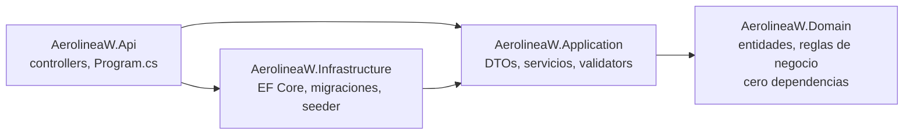
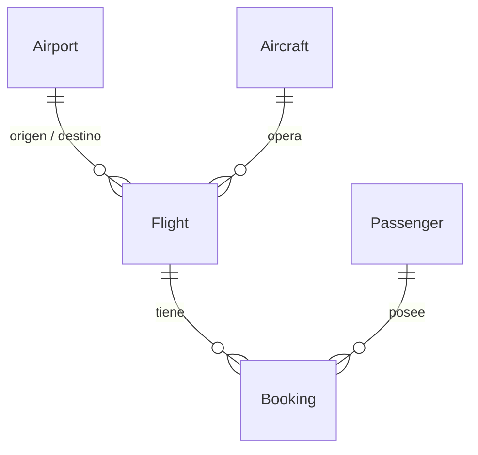

# AerolineaW

[](https://github.com/WVillarr/AerolineaW/actions/workflows/ci.yml)

Una API de operaciones de aerolínea — aeropuertos, aeronaves, vuelos y reservas — construida
como reescritura de portafolio de un proyecto de aprendizaje anterior. El objetivo de la
reescritura no fue agregar una interfaz o más endpoints; fue reemplazar un modelo de datos pobre
por uno real y dejar que una capa de dominio propiamente dicha cargue con las reglas de negocio
que hacen interesante a un sistema de aerolínea de verdad: capacidad de asientos, tiempo de
turnaround entre vuelos, ventanas de check-in y — la que vale la pena mirar con más detalle —
qué pasa cuando dos personas intentan reservar el último asiento en el mismo instante.

[English](README.md)

## Arquitectura

Clean Architecture, cuatro proyectos, dependencias apuntando en una sola dirección:



`Domain` no tiene ninguna referencia a paquetes: cada regla de negocio es C# plano, testeada sin
base de datos, sin mocks y sin ASP.NET Core de por medio. `Application` define
`IApplicationDbContext` y solo referencia el paquete agnóstico de proveedor
`Microsoft.EntityFrameworkCore`; `Infrastructure` implementa esa interfaz contra SQL Server. Es
una excepción deliberada y acotada a "Application no debería conocer EF Core" — la alternativa
(una abstracción completa de repositorio sobre `IApplicationDbContext`) es un patrón de Clean
Architecture reconocido por derecho propio, pero agrega una capa de indirección que el alcance
de este proyecto no justifica.

## El modelo de dominio



Esto reemplaza al `Ticket` del proyecto original, que aplanaba un vuelo y la reserva de un
pasajero en una sola fila, y a su par `Airport1`/`Airport2` — dos entidades estructuralmente
idénticas pensadas para representar salida y llegada, cuyo significado se contradecía según qué
archivo se leyera.

## Reglas de negocio

Cada regla de la tabla vive en la propia entidad (`Flight`, `Booking`) — no en un servicio, y no
duplicada en cada llamador.

| Regla | Dónde se aplica |
|---|---|
| El origen y el destino de un vuelo deben ser distintos | Constructor de `Flight` |
| La llegada programada debe ser posterior a la salida programada | Constructor de `Flight` |
| No se puede asignar una aeronave `InMaintenance` o `Retired` | `Flight.AssignAircraft` |
| Una aeronave no puede tener vuelos solapados — incluyendo un margen de turnaround de 45 minutos | `FlightService` (requiere consulta, por eso no puede vivir en Domain) |
| No se venden más reservas que `Aircraft.SeatCapacity` | `Flight.Book` |
| Un asiento, una reserva | índice único en `(FlightId, Seat)` |
| El equipaje total no puede superar `Aircraft.MaxPayloadKg` | `Flight.Book` |
| Las reservas cierran 45 minutos antes de la salida programada | `Flight.Book` |
| Transiciones de estado: `Scheduled → Boarding → InFlight → Landed`, con ramas laterales `Delayed`/`Cancelled` | `Flight.Board/Depart/Land/Delay/Cancel` |
| El check-in abre 24 h y cierra 45 min antes de la salida | `Booking.CheckIn` |
| Cancelar un vuelo cancela todas sus reservas activas | `Flight.Cancel` |
| Cancelar una reserva libera el asiento de vuelta al vuelo | `Booking.Cancel` |

### La que vale la pena observar: reservas concurrentes

`Flight.SeatsBooked` es un contador almacenado, no un `Bookings.Count` calculado al leer — cada
llamada a `Flight.Book()` lo incrementa, así que cada reserva emite un `UPDATE` contra la fila de
`Flight`. Combinado con una columna `rowversion` de SQL Server como token de concurrencia de EF
Core, esto significa que dos reservas compitiendo por el último asiento producen un conflicto de
concurrencia optimista real: la solicitud perdedora recibe `DbUpdateConcurrencyException`, y
`BookingService` reintenta — hasta tres veces — releyendo el vuelo desde cero y revalidando la
capacidad contra lo que realmente está confirmado, en vez de asumir que la solicitud original
estaba mal.

`BookingsConcurrencyTests.ConcurrentBookings_ExactlySeatCapacitySucceed` dispara 12 solicitudes
de reserva simultáneas contra una aeronave de 6 asientos y verifica que exactamente 6 tengan
éxito — ni menos (un bug perdería silenciosamente una reserva válida) ni más (un bug vendería de
más el vuelo).

## Stack técnico

- **.NET 10** / ASP.NET Core, C# 13
- **EF Core 10** sobre SQL Server, migraciones code-first
- **FluentValidation** para validar la forma de los requests (campos vacíos, longitudes) — las reglas de negocio se quedan en Domain
- **Mapster** para el mapeo entidad → DTO
- **Serilog** para logging estructurado, **Asp.Versioning** (`/api/v1/...`), **Swashbuckle** para Swagger
- **xUnit** — 82 tests unitarios puros sobre Domain, más una suite de integración con **Testcontainers** contra un SQL Server real (y descartable)
- **Docker Compose** para arrancar todo en un comando, **GitHub Actions** para CI

## Arranque rápido

Requiere Docker.

```bash
cp .env.example .env
# editar .env: poner MSSQL_SA_PASSWORD con algo que cumpla la política de complejidad de SQL Server
docker compose up --build
```

Swagger: <http://localhost:8080/swagger>. En el primer arranque, `Database.MigrateAsync()` y un
seeder de datos de demo corren automáticamente (solo en el entorno Development) — 10 aeropuertos
reales, 6 aeronaves, 40 pasajeros y ~24 vuelos cubriendo cada `FlightStatus`, para tener algo que
explorar de inmediato.

## Desarrollo local (sin Docker)

Requiere el SDK de .NET 10 y, o bien SQL Server, o SQL Server Express LocalDB.

```bash
dotnet build
dotnet run --project src/AerolineaW.Api
```

`appsettings.Development.json` apunta por defecto a `(localdb)\MSSQLLocalDB` — cero configuración
en cualquier máquina Windows con las herramientas de SQL Server instaladas. Apuntá
`ConnectionStrings:AirlineDatabase` a otra instancia (o usá `dotnet user-secrets`) si preferís
otra cosa.

## Tests

```bash
# Solo los tests unitarios de Domain — rápidos, sin dependencias externas
dotnet test tests/AerolineaW.Domain.UnitTests

# Todo, incluyendo la suite de integración con Testcontainers (necesita Docker corriendo)
dotnet test
```

## Recorrido por la API

```bash
# Crear un aeropuerto
curl -X POST http://localhost:8080/api/v1/airports \
  -H "Content-Type: application/json" \
  -d '{"code":"MIA","name":"Miami International","city":"Miami","country":"United States","timeZoneId":"America/New_York"}'

# Reservar un asiento
curl -X POST http://localhost:8080/api/v1/flights/1/bookings \
  -H "Content-Type: application/json" \
  -d '{"passengerId":1,"seat":"14A","baggageWeightKg":15,"price":249.99}'

# Buscar una reserva por su referencia de 6 caracteres — sin necesitar el id del vuelo
curl http://localhost:8080/api/v1/bookings/by-reference/3F9K2X
```

Todo rechazo por regla de negocio vuelve como un cuerpo
[RFC 7807](https://www.rfc-editor.org/rfc/rfc7807) `ProblemDetails` con el código de estado
correcto (404 no encontrado, 409 conflicto de negocio, 400 validación) — nunca una excepción
cruda, que es justo lo que hacía el `catch (Exception e) { return StatusCode(500, e); }` en cada
acción de cada controller del proyecto original.

## Decisiones de diseño que conviene conocer antes de leer el código

- **`Application` referencia `Microsoft.EntityFrameworkCore`.** Documentado arriba — una
  excepción deliberada y acotada, no un descuido.
- **`Booking` solo se crea a través de `Flight.Book()`, pero se lee y muta (check-in, cancelar)
  directamente después**, sin recargar siempre el agregado `Flight` completo. Un límite de
  agregado DDD de manual haría pasar cada mutación por la raíz; eso implicaría cargar todas las
  reservas de un vuelo solo para hacer el check-in de un pasajero, algo que el patrón de acceso
  real de un sistema de reservas — "buscá este PNR directamente, no sé en qué vuelo está" —
  desaconseja. Ver el `<remarks>` de `Booking` para el razonamiento completo.
- **El seeder de demo corre `Database.MigrateAsync()` al arrancar**, solo en Development. El
  proyecto original aplicaba migraciones exclusivamente a mano; esto lo cambia por "un solo
  comando arranca todo el stack", que importa más para un proyecto pensado para que un
  desconocido lo clone y lo corra que para uno pensado para operarse en producción tal cual.

## Lo que no está acá

Autenticación/autorización quedó fuera de alcance — todos los endpoints están abiertos. Si esto
avanzara, JWT con un rol `Admin` (gestiona flota/vuelos) y un rol `Customer` (reserva/hace
check-in) sería la siguiente fase natural.
