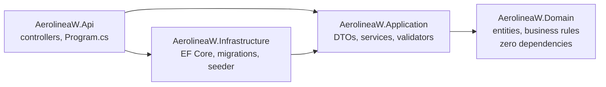
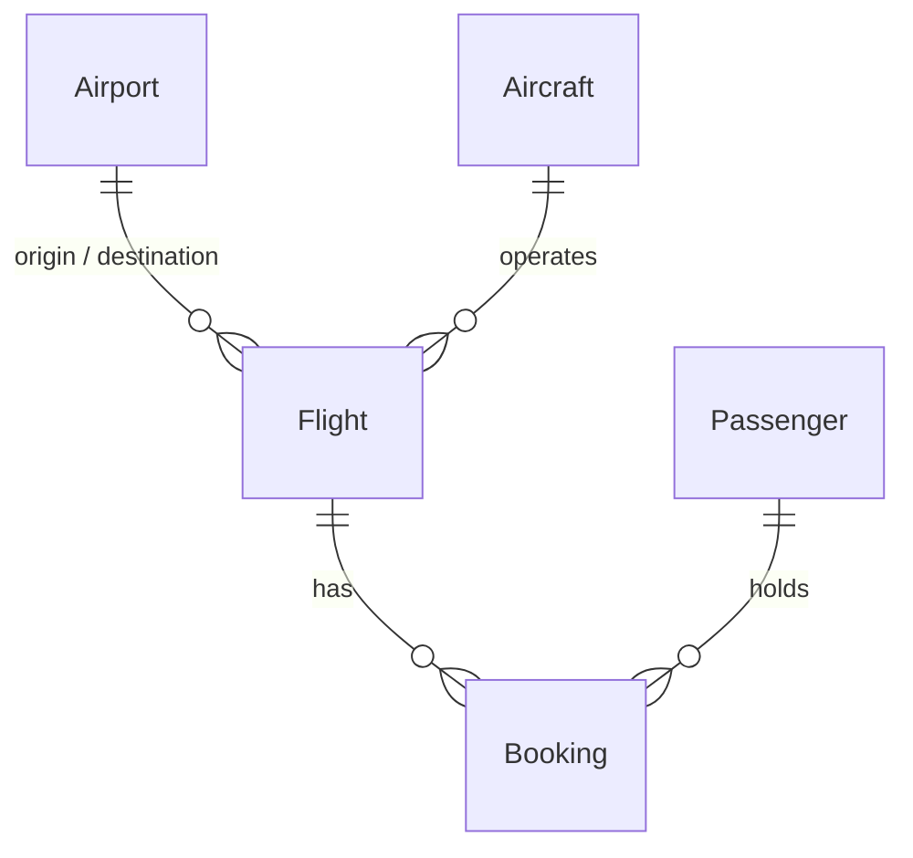

# AerolineaW

[](https://github.com/WVillarr/AerolineaW/actions/workflows/ci.yml)

An airline operations API — airports, aircraft, flights, and bookings — built as a portfolio
rewrite of an earlier learning project. The point of the rewrite wasn't to add a UI or more
endpoints; it was to replace an anemic data model with a real one and let a proper domain layer
carry the business rules that actually make an airline system interesting: seat capacity,
turnaround time between flights, check-in windows, and — the one worth a second look — what
happens when two people try to book the last seat at the same instant.

[Español](README.es.md)

## Architecture

Clean Architecture, four projects, dependencies pointing one direction only:



`Domain` has no package references at all — every business rule is plain C#, unit-tested
without a database, a mock, or ASP.NET Core in the loop. `Application` defines
`IApplicationDbContext` and references only the provider-agnostic `Microsoft.EntityFrameworkCore`
package; `Infrastructure` implements that interface against SQL Server. That's a deliberate,
narrow exception to "Application shouldn't know about EF Core" — the alternative (a full
repository abstraction over `IApplicationDbContext`) is a well-known Clean Architecture pattern
in its own right, and adds a layer of indirection this project's scope doesn't earn back.

## The domain model



This replaces the original project's `Ticket` entity, which flattened a flight and a passenger's
reservation into one row, and its `Airport1`/`Airport2` pair — two structurally identical
entities meant to represent departure and arrival, whose meaning contradicted itself depending on
which file you read.

## Business rules

Every rule below lives on the entity itself (`Flight`, `Booking`) — not in a service, and not
duplicated across callers.

| Rule | Enforced in |
|---|---|
| A flight's origin and destination must differ | `Flight` constructor |
| Scheduled arrival must be after scheduled departure | `Flight` constructor |
| An aircraft can't be assigned while `InMaintenance` or `Retired` | `Flight.AssignAircraft` |
| An aircraft can't be double-booked — overlapping flights, including a 45-minute turnaround buffer | `FlightService` (needs a query, so it can't live in Domain) |
| No more bookings than `Aircraft.SeatCapacity` | `Flight.Book` |
| One seat, one active booking; cancelled seats can be resold | filtered unique index on `(FlightId, Seat)` |
| Total baggage can't exceed `Aircraft.MaxPayloadKg` | `Flight.Book` |
| Bookings close 45 minutes before scheduled departure | `Flight.Book` |
| Status transitions: `Scheduled → Boarding → InFlight → Landed`, with `Delayed`/`Cancelled` side branches | `Flight.Board/Depart/Land/Delay/Cancel` |
| Check-in only opens 24h and closes 45 minutes before departure | `Booking.CheckIn` |
| Cancelling a flight cancels every active booking on it | `Flight.Cancel` |
| Cancelling before departure releases the seat and baggage; cancellation after departure is rejected | `Booking.Cancel` |
| Aircraft reassignment must accommodate booked seats and baggage | `Flight.AssignAircraft` |
| Actual arrival must be after actual departure | `Flight.Land` |

### The one worth watching: concurrent bookings

`Flight.SeatsBooked` is a stored counter, not `Bookings.Count` computed on read — every
`Flight.Book()` call increments it, so every booking issues an `UPDATE` against the `Flight` row.
Paired with a SQL Server `rowversion` column as an EF Core concurrency token, that means two
bookings racing for the last seat produce a real optimistic-concurrency conflict: the losing
request gets `DbUpdateConcurrencyException`, and `BookingService` retries — up to three
attempts — by re-reading the flight fresh and re-checking capacity against what's actually
committed, rather than assuming the original request was wrong.

`ConcurrentBookings_NeverOversell_AndRemainingCapacityCanBeSold` fires 12 simultaneous
requests at a 6-seat aircraft and verifies there is no overselling. Three server attempts may
exhaust under contention even with seats remaining: that 409 lets the client retry explicitly.
The test also checks that remaining capacity can still be sold afterward. Additional tests hold
two independent contexts before saving to exercise races for the same seat and the last seat.

`Booking` also has a `rowversion`: a stale check-in cannot overwrite a committed cancellation.
Flight creation and aircraft reassignment check availability and save inside a `Serializable`
transaction, replaying the entire operation through EF Core's execution strategy when needed.

## Tech stack

- **.NET 10** / ASP.NET Core, C#
- **EF Core 10** on SQL Server, code-first migrations
- **FluentValidation** for request-shape validation (empty fields, lengths) — business rules stay in Domain
- **Mapster** for entity → DTO mapping
- **Serilog** structured logging, **Asp.Versioning** (`/api/v1/...`), **Swashbuckle** for Swagger
- **xUnit** — 91 pure unit tests on Domain, plus a **Testcontainers**-backed integration suite against a real (disposable) SQL Server
- **Docker Compose** for one-command local startup, **GitHub Actions** CI

## Quick start

Requires Docker.

```bash
cp .env.example .env
# edit .env: set MSSQL_SA_PASSWORD to something meeting SQL Server's complexity policy
docker compose up --build
```

Swagger: <http://localhost:8080/swagger>. On first run, `Database.MigrateAsync()` and a demo
data seeder run automatically (Development environment only) — 10 real airports, 6 aircraft, 40
passengers, and ~24 flights across every `FlightStatus`, so there's something to browse
immediately.

## Local development (without Docker)

Requires the .NET 10 SDK and either SQL Server or SQL Server Express LocalDB.

```bash
dotnet build
dotnet run --project src/AerolineaW.Api
```

`appsettings.Development.json` points at `(localdb)\MSSQLLocalDB` by default — zero setup on any
Windows machine with SQL Server tooling installed. Point `ConnectionStrings:AirlineDatabase` at a
different instance (or use `dotnet user-secrets`) if you'd rather use something else.

## Testing

```bash
# Domain unit tests only — fast, no external dependencies
dotnet test tests/AerolineaW.Domain.UnitTests

# Everything, including the Testcontainers integration suite (needs Docker running)
dotnet test
```

## Reproducible API walkthrough

With Docker Compose running, execute in PowerShell from the repository root:

```powershell
./scripts/demo.ps1
```

For the local HTTP launch profile (`dotnet run --project src/AerolineaW.Api`):

```powershell
./scripts/demo.ps1 -BaseUrl http://localhost:5129
```

On Linux/macOS, install PowerShell and run `pwsh -File scripts/demo.ps1`.
The script uses two seeded airports and creates an aircraft, passenger, and flight departing
in 12 hours. It books `1A`, looks up the reference returned by the API, checks in, cancels, and
books that seat again. It verifies history and counters, then returns the actual IDs and
references of both bookings. Each execution adds its own demonstration data.

Errors use `ProblemDetails`: 400 for validation, 404 for missing resources, and 409 for business
rules, concurrency, and expected unique-key or foreign-key conflicts. Unexpected persistence
failures return a generic 500 and are logged server-side.

## Release verification

```bash
dotnet format --verify-no-changes
dotnet build --configuration Release
dotnet test --configuration Release
```

CI runs both suites with Testcontainers, builds the image, and starts Compose with an empty
database. It checks `/health`, Swagger, seeded flights, and the same PowerShell walkthrough;
it collects results and logs before removing only that run's resources. The suite also tests
upgrading an initial-schema database containing existing bookings.

When Docker is unavailable, an existing SQL Server instance can run the tests:

```powershell
$env:AEROLINEAW_TEST_SQLSERVER = 'Server=(localdb)\MSSQLLocalDB;Integrated Security=true;TrustServerCertificate=true'
dotnet test --configuration Release
Remove-Item Env:AEROLINEAW_TEST_SQLSERVER
```

Only the supplied server and credentials are used to create disposable databases named
`AerolineaW_Tests_<guid>` and `AerolineaW_MigrationTests_<guid>`, removed at teardown. The database
named in the connection string is never the target. The account needs database create/drop
permissions. This verifies SQL Server integration; it does not verify Docker or Compose.

Incremental migrations run automatically only in Development. Elsewhere, apply them explicitly
with `dotnet ef database update --project src/AerolineaW.Infrastructure --connection "<connection-string>"`. Rolling back to the
initial schema requires resolving reused seats first: its original index cannot represent two
historical bookings for the same seat. History is never deleted automatically.
Personal Codex skills are not prerequisites for running or verifying this repository.

## Design decisions worth knowing before reading the code

- **`Application` references `Microsoft.EntityFrameworkCore`.** Documented above — a deliberate,
  scoped exception, not an accident.
- **`Booking` is created only through `Flight.Book()`, but read and mutated (check-in, cancel)
  directly afterward**, not by always reloading the whole `Flight` aggregate. A textbook DDD
  aggregate boundary would route every mutation through the root; that would mean loading every
  booking on a flight just to check one passenger in, which a booking system's own real-world
  access pattern — "look this PNR up directly, I don't know what flight it's on" — argues
  against. See the `<remarks>` on `Booking` for the fuller reasoning.
- **The demo seeder runs `Database.MigrateAsync()` on startup**, in Development only. The
  original project applied migrations by hand exclusively; this trades that for "one command
  actually starts the whole stack," which matters more for a project meant to be cloned and run
  by a stranger than for one meant to be operated in production as-is.

## What's not here

Authentication/authorization was scoped out — every endpoint is open. If this went further,
JWT with an `Admin` role (manages fleet/flights) and a `Customer` role (books/checks in) would be
the natural next phase.

This is a backend demonstration without payments or a user interface. Prices are supplied by
the caller; there is no fare engine. Seats are validated by format and uniqueness, without a
physical cabin map. Reserved payload models baggage only, not total aircraft operating weight.
Use fictional data: open endpoints are not a platform for real passengers.
